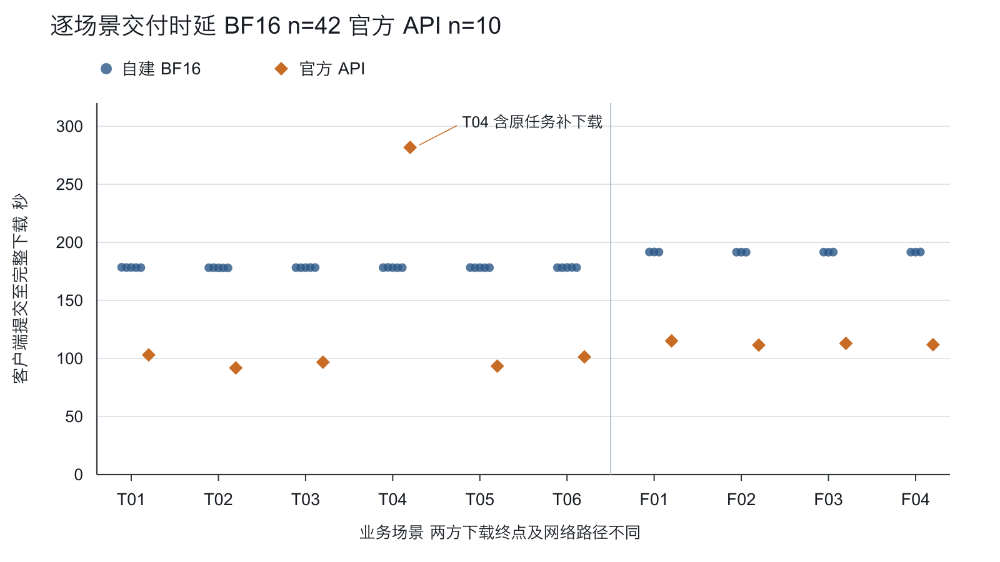
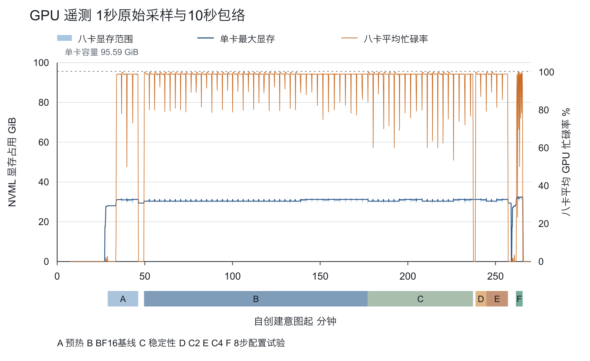
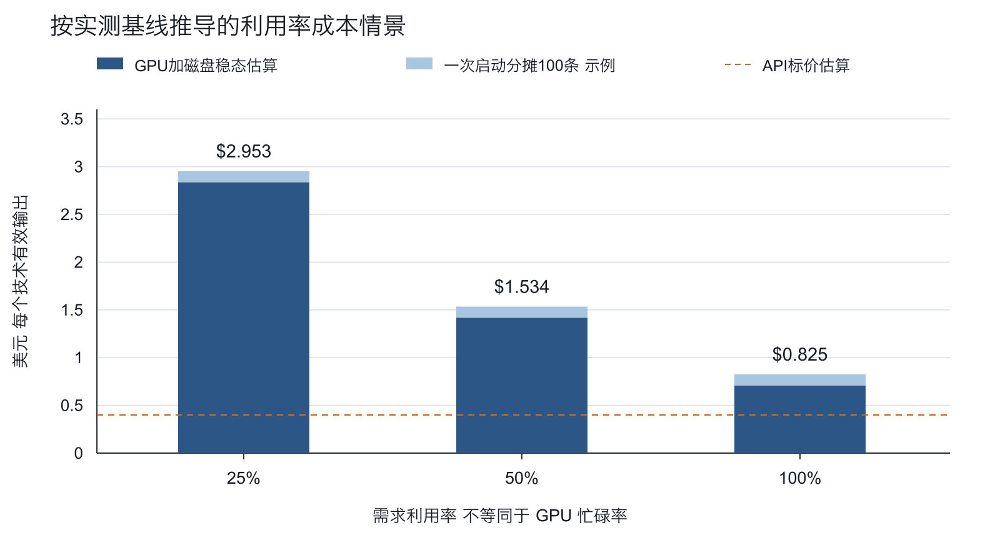

# MiniMax H3 八卡 RTX PRO 6000 实测报告

实测日期：2026年11月7日。

自费 PoC；T2VA 文生有声视频与首帧 FL2VA；官方国际站 API 业务对照。金额均为美元，时间轴统一使用 UTC；当日洛杉矶当地时间为 UTC−8。

## 决策摘要

本轮已在单机八张完整 RTX PRO 6000 Blackwell Server Edition 上运行固定 vLLM Omni 0.32.0 与 MiniMax H3。模型和推理环境仅在租用服务器准备，笔记本未安装 H3 环境、未下载或中转模型权重。标准 BF16 基线实际完成 42/42 条技术有效视频；官方 API 完成10/10，首轮完整下载9/10，另一次沿用原任务补下载。

| 组别 | 有效 n | P50 秒 | P95 秒 | 范围 秒 |
| --- | --- | --- | --- | --- |
| BF16 T2VA | 30 | 178.23 | 178.43 | 177.94–178.55 |
| BF16 FL2VA | 12 | 191.61 | 191.72 | 191.50–191.73 |
| 官方API 全场景 | 10 | 107.30 | 206.78 | 91.85–281.78 |

技术有效指 HTTP/文件格式检查、实际规格检查和完整音视频解码通过，不等于业务可交付。人工提示词遵循、运动、首帧保持、音频和同步评分按实际用户评审填写；尚未评分的部分明确保留缺失。自建延迟的下载终点位于服务器，API 的下载终点位于笔记本，两者网络路径不同。

按完整基线窗口核算，稳态技术有效输出间隔为 182.33 秒，GPU 加已分配磁盘估算为每条 $0.709。API 按返回的50个计费秒和执行时标价估算为10条 $4.00，约每条 $0.40。BF16当前配方的直接资源成本高于API标价估算，整体交付时延也更长；但两方测量路径不同。当前数据不支持仅为降本扩大自建。人工质量待补，Turbo激活未证实；是否继续还需结合质量和数据部署需求。

本次自建Vast余额支出观测 $64.90，加API标价估算后合计 $68.90，实际API结算待核实。充值 $120 是资金存入，不能当作全部消耗。实例释放状态：已独立确认销毁，且没有本轮不再需要的存储。

## 实验范围和方法

本轮以单机八卡为单位，测试 MiniMax H3 的文生有声视频 T2VA 和首帧条件生成 FL2VA。标准配方采用固定版本 vLLM Omni、BF16 主配置、TP4 与 Ulysses2、ring1、text encoder TP8，以及八卡 VAE tile 并行。测试的业务交付规格为 1344×768、24 fps、名义五秒、有音轨的视频。官方国际站 API 对照使用相同场景提示词和首帧文件，名义五秒、768P；API 的内部 seed、步数、软件版本和优化不可见。

样本设计为六个 T2VA 场景各五个 seed，共三十条；四个 FL2VA 场景各三个 seed，共十二条。T2VA seed 为1101至1105，FL2VA为2101至2103。预热为每种任务两条，分别检查同步和异步接口。独立稳定性窗口为六十分钟；并发观察为客户端 C2 和 C4 各一批。可选 Turbo 设计为最多六条匹配样本，三条 T2VA 和三条 FL2VA，并与标准配方分开报告。逐场景提示词、检查清单和素材哈希在冻结矩阵及附件中保留。

## 实测硬件环境

| 项目 | 观测值 |
| --- | --- |
| 提供方和位置 | Vast Texas 单机，offer55456241，instance59566113，machine153605 |
| GPU | 八张 NVIDIA RTX PRO 6000 Blackwell Server Edition |
| 每卡显存 | nvidia-smi 每卡97887MiB，八张卡具有不同PCI bus ID，MIG全部Disabled |
| 负载链路采样 | 八卡均为PCIe Gen5、x16；每卡功率限制600W，未修改功率限制 |
| CPU | 两路AMD EPYC9555，每路64个物理核、每核两个线程，共256线程 |
| 内存 | 宿主811074256896字节，约755.37GiB；容器有效内存上限778630594560字节，约725.15GiB |
| 磁盘 | 实例分配500GB；df返回总容量536870912000字节。最大可租磁盘不作为已分配容量 |
| NUMA | 两个节点；GPU0至3属于节点0，GPU4至7属于节点1 |
| P2P | Torch查询八卡两两可达；NCCL八进程all-reduce和all-to-all正确性通过 |

每卡显存单独使用，八张卡不会形成单卡统一显存。Vast 的 Verified、历史可靠度99.42%与DLPerf1333.1只用于选择现货；这些不是本轮的稳定性或H3性能结论。PCIe代际、链路宽度和功率限制来自运行采样；没有进行独立存储性能、卡数或拓扑顺序对比。

32MiB每rank的NCCL小样包含三次预热和十次计时。all-reduce的最慢rank平均为3.3165ms，按每rank payload计算为10.1174GB/s；all-to-all为1.8461ms、18.1757GB/s。这些是正确性和小消息样例数据，不是完整nccl-tests总线带宽，也不能换算成H3速度。

## 软件和权重

| 项目 | 观测值或固定身份 |
| --- | --- |
| 容器系统 | Ubuntu24.04.3 LTS，x86_64 |
| 共享宿主内核 | Linux6.8.0-100146-generic；宿主用户空间操作系统在容器内不可见 |
| 驱动 | 615.71.09 |
| Python | 3.12.3 |
| Torch | 2.13.0+cu130，torch.version.cuda为13.0 |
| cuDNN | torch查询返回92000 |
| NCCL | Torch运行时查询2.29.7 |
| vLLM和vLLM Omni | 均为0.32.0 |
| Diffusers | 0.40.0 |
| Transformers | 5.19.0 |
| Hugging Face Hub | 1.33.0 |
| PEFT | 0.21.2 |

镜像固定为 `vllm/vllm-omni@sha256:6b44ee504a0dc3a21eacf72e7dc5da318b7bcc8ed0e349dc928e67278414430c`。源码参考tag为v0.32.0，解析到commit `5917730a4b02aedb44d374173cdc1b10484ccd52`。已安装MiniMaxH3Pipeline文件与该参考源码仅有末尾空行差异，Python AST相同；实际文件哈希与对比记录均保留。完整镜像身份以摘要为准。

模型来自MiniMaxAI/MiniMax-H3，revision固定为 `42ed227ee7df40d41602854ae760620d6eb651fe`，仅下载FL2VA分区。81个文件共144051182625字节，逐文件大小、LFS SHA256或Git blob SHA1校验通过。下载和校验从12:08:35Z至12:25:04Z，共989.668秒。下载器、权重、H3运行时和完整媒体工具都在租用服务器上运行；笔记本只承担标准库控制、官方API请求、结果回传和既有文档工具导出。

运行配置类的dtype默认值为torch.bfloat16。权重头元数据中，text encoder为BF16，transformer含BF16和F32张量，音频和视频VAE权重为F32；不能将所有组件写成统一的BF16存储。组件内部类型转换遵循固定实现。本轮未额外启用FP8、FP4或近似加速。配置声明中的缓存策略为none，prompt embed cache为false，CPU、layerwise和distributed layerwise offload为false；编译粒度默认regional、dynamic为true。配置声明与实际启动参数分别留存；运行中引擎对象的全量有效配置未导出。

## 实际启动和协议修正

本机真实拓扑下采用GPU顺序0至7。固定源码的RankGenerator顺序为tp-sp-pp-cfg-dp，TP4的连续rank位于同一NUMA节点，Ulysses2跨节点。该选择保留了相邻PIX对，但未进行其它rank顺序对比，不主张这是最优映射。

初次 `numactl --interleave=0,1` 启动返回Operation not permitted。保留失败日志后，验证并采用 `numactl --cpunodebind=0,1`；内存策略为容器默认，未成功启用interleave，也未放宽宿主安全策略。实际命令为：

```bash
CUDA_VISIBLE_DEVICES=0,1,2,3,4,5,6,7 \
VLLM_WORKER_MULTIPROC_METHOD=spawn \
VLLM_OMNI_VIDEO_SYNC_TIMEOUT=1800 \
numactl --cpunodebind=0,1 \
vllm serve /data/models/MiniMax-H3/FL2VA --omni \
  --host 127.0.0.1 --port 8091 --trust-remote-code \
  --num-gpus 8 --tensor-parallel-size 4 --usp 2 --ring 1 \
  --text-encoder-tp-size 8 --vae-patch-parallel-size 8 \
  --vae-parallel-mode tile --vae-use-tiling \
  --diffusion-attention-backend CUDNN_ATTN
```

自建请求显式发送宽高、24fps、50步、seed、flow shift12与audio flow shift3，并请求stage metrics。T2VA必须显式传aspect_ratio=16:9，FL2VA采用首帧比例；请求同时传short_edge=768和名义duration=5。初次适配漏传T2VA比例被HTTP400拒绝，服务日志确认输入阶段终止后才作下一次独立尝试。原attempt1、确认依据和成功attempt2全部保留。

固定运行时中，请求50步对应51个sigma点；实际执行更新数以每条串行请求日志区间中的完整50/50计数器为证据。不能将参考配方中的49次更新直接套用。并发请求的日志区间重叠时，不作逐请求计数器归因。输出帧数、像素、视频和音频时长按ffprobe逐条读取，不强行裁成五秒。

## 统计和质量口径

自建客户端与服务位于同一容器，经127.0.0.1请求并将MP4下载到服务器；官方API客户端在笔记本，经公网访问API和CDN。主E2E从各自客户端提交开始计到MP4完整下载，不含后续解码验证时间。官方API结果在租用服务器统一完成媒体校验，下载与校验之间的跨主机等待另保留时间戳，不解释为API推理耗时。自建回传至笔记本的时间另作归档链路观测，不包含在服务端本地E2E中。回传监视器启动前已存在的文件无法回溯首次到达时刻，相关字段保留缺失，且两端时钟未独立校准。两方没有采用相同网络路径，不能将表中差异解释为纯模型推理速度差。同步响应保存HTTP状态、Content-Type、请求ID、推理时长、峰值显存和可用stage字段；异步任务在返回ID后立即落盘，再轮询查询与下载。轮询间隔设为两秒，但实际发现误差上界包含请求往返时间，不能写成精确两秒。官方T04的补下载时间保留在真实交付E2E中。

保存MP4前先检查HTTP状态、类型和ftyp签名，再运行ffprobe和ffmpeg全文件音视频解码。存在音轨、解码成功和音频信号非全零都不能代替人工音画同步、语义或可交付性评分。服务公开的阶段时延主要为queue_wait_ms和stage_0_gen_ms。已安装源码中，queue_wait_ms量的是入队到Orchestrator登记的间隔，扩散调度器另有内部排队指标；该内部指标未出现在本轮HTTP响应中。stage_0_gen_ms按服务阶段返回，不等同于独立去噪计算时间。metrics中未填充的0.0字段也不当作组件耗时实测。独立text encoder、denoiser和VAE时间保留缺失，不作相减或分摊推算。

预热、BF16主基线、六十分钟稳定性、C2、C4和Turbo分别统计。P50、P95按排序后(n−1)乘分位点作线性插值，同时报告n、最小和最大值。三十条T2VA、十二条FL2VA以及更小的并发和Turbo样本只能提供初步尾部参考。六十分钟观测不能当作生产SLA。

吞吐使用整个观察窗口的成功输出数除以窗口墙钟时间。并发成本按整机窗口计一次；不能将每条E2E乘整机单价后相加。GPU遥测约一秒采样，显存峰值为采样最大值，不能排除采样间隙中的短瞬态。模型输入、版本和素材哈希均在逐条数据中保存。

质量采用提示词遵循、画面与运动、首帧保持、音频和音画同步五项1至5分；T2VA首帧保持不适用。可交付性独立选择是、否或不确定。十个场景各选自建固定最小seed与一条官方结果，随机分配A/B标签，不挑选好看结果。项目发起人为首位人工评审，评分锁定后再解盲。没有评分就保留缺失，不虚构评审者、分数或可交付率。

## 成本与预算口径

预算上限为GPU120美元、磁盘和流量20美元、官方API10美元，总额150美元，累计GPU计费不超过八小时。账本在收费动作前检查已花费、待结算、下一任务最坏费用和二十五分钟归档释放预留。部署、下载、失败、等待、回传及释放前的闲置都计入本次自建总成本。

Vast精确价格来自实例接口：八卡GPU为13.86666667美元每小时，500GB磁盘为0.13888889美元每小时，合计14.00555556美元每小时。预算守卫使用向上取整的13.867和0.139。创建意图时间为12:00:31.289889Z；提供方start_date对应12:00:39.198850Z。保护边界按较早的意图时间计算，不能从SSH成功或模型就绪才起算。

成本分为稳态服务、本次自建全部窗口，以及加官方对照后的完整PoC。25%、50%、100%的需求利用率是业务请求占可服务时间的比例，不等同于NVML的GPU忙碌率。冷启动分摊示例必须写明一次启动对应多少个成功输出；一百条或一千条属于情景假设，不是本次实测吞吐或业务需求。

充值120美元是账户资金，不等于本次已消耗费用。官方API当前按五十个计费输出秒和公开单价估算为4美元，实际账单未取得前仍标记估算。人工工时未计时，作为缺失单列，不编造小时费率或将其隐入云费用。关闭服务只停止推理，必须在结果回传并核验后销毁实例、确认没有不再需要的存储，并独立核对计费状态。

## 请求协议与复现顺序

本轮同步接口为 `POST /v1/videos/sync`，异步为 `POST /v1/videos`、`GET /v1/videos/{id}` 和 `GET /v1/videos/{id}/content`。首帧以 multipart 文件字段 `input_reference` 发送，内容与冻结PNG逐字节一致。标准T2VA的核心表单如下，提示词替换为冻结场景全文；FL2VA使用aspect_ratio=adaptive、task=fl2va并附首帧。

```text
prompt = 冻结场景全文
width = 1344
height = 768
fps = 24
aspect_ratio = 16:9
short_edge = 768
num_inference_steps = 50
seed = 1101
flow_shift = 12
return_stage_metrics = true
extra_params = {"task":"t2va","duration":5.0,"audio_flow_shift":3.0}
```

官方使用 `POST https://api.minimax.io/v2/video_generation` 与 `GET /v2/query/video_generation/{task_id}`。T2VA请求的核心JSON如下；FL2VA的ratio改为adaptive，并向content添加role为first_frame的image_url对象。本轮image_url使用同一冻结PNG的data URL，未更换图片或另行收费生成。官方seed与步数未公开。

```json
{
  "model": "MiniMax-H3",
  "resolution": "768P",
  "duration": 5,
  "ratio": "16:9",
  "content": [
    {"type": "text", "text": "冻结场景全文"}
  ]
}
```

复现应在新的、重新授权并验收的8卡服务器和干净结果目录进行。先解压交付包中的冻结harness源码，放入同版cases与config，登记新的租赁时钟、费率和硬释放边界，再下载及校验固定FL2VA文件。不能复用本次实例ID、凭据或已完成请求目录。硬件映射须按新机器拓扑填写，本轮cpu-bind参数的适用性也需重新核实。

本轮主流程在同步及异步各任务预热通过后，运行以下协调器完成42条基线并自动开始独立60分钟稳定性；单次基线窗口到时只续交未提交样本，已有失败或不明提交不会自动重提。之后先人工核对稳定性终态，再执行只读过渡检查；通过后才运行C2/C4，可选Turbo再独立启动并限时。

```bash
python3 scripts/baseline_stability.py
python3 control/review_stability_gate.py
python3 control/concurrency_session.py --execute
python3 control/turbo_session.py --execute
```

以上为本次复现入口，不是对未来资源消费的授权。实际客户端负责先核对HTTP状态、Content-Type和MP4签名，再落为视频，随后ffprobe和全文件解码；直接把任意HTTP响应写成MP4不属于本轮验证流程。超时提交必须优先核实已有任务ID，不以自动重复POST掩盖失败。


## 执行时间轴与止损检查

| 事件 | UTC 时间 | 证据与含义 |
| --- | --- | --- |
| 首条官方API下载 | 11:42:33 | 生成验证先于GPU租赁，计入10条对照 |
| 创建及预算计费起点 | 12:00:31 | 按创建意图计时，含所有部署与等待 |
| 八卡硬件及通信验收 | 12:07:44 | 距创建7.22分钟，20分钟止损内通过 |
| 模型下载与校验完成 | 12:25:04 | 仅服务器FL2VA，81文件，耗时989.67秒 |
| 首份自建视频完整验证 | 12:37:17 | 距创建36.77分钟，120分钟止损内通过 |
| 主基线42条完成 | 14:57:42 | 对应阶段原始终态单独保留 |
| 独立稳定性结束 | 15:57:43 | 对应阶段原始终态单独保留 |
| 并发观察结束 | 16:17:36 | 对应阶段原始终态单独保留 |
| 可选Turbo会话结束 | 16:26:12 | 对应阶段原始终态单独保留 |
| 本机归档核验完成 | 16:34:10 | 逐文件大小及SHA256核验，之后才正常销毁 |
| 实例和存储释放确认 | 16:35:35 | 独立检查Vast实例与不再需要的存储状态 |

所有时间均为2026年11月7日UTC，源文件保留毫秒及完整时区。硬释放边界预先设为19:55:31 UTC，比累计8小时至少提前5分钟；本次没有通过重启服务或换阶段重置租赁时钟。硬件未通过20分钟、累计付费2小时无有效视频、不可恢复GPU或通信故障均为止损条件；本轮硬件和首视频条件已在限时内通过，后续异常按原始记录报告。

## 功能与媒体有效性结果

| 实际规格组合 | 数量 |
| --- | --- |
| 1344×768 / 24.0fps / 124帧 / h264 + aac / 32000Hz / 2声道 | 87 |

逐条原始规格保留在 ffprobe 与 CSV。T2VA请求比例为16:9，实际1344×768的像素比例为7:4；原生输出按实测像素记录。视频流以帧数除以帧率约为5.166667秒；自建容器与音轨通常5.175秒，API容器约5.167秒。容器或编码尾部长度差异不能直接解释为音画不同步；同步必须实际观看和听音。所有成功样本的 ffmpeg 全文件音视频解码退出码为0，解码时间单列，不混入主 E2E。

| 音频信号检查 | n | 分析失败 | 全数字静音 |
| --- | --- | --- | --- |
| 自建 | 77 | 0 | 0 |
| 官方 API | 10 | 0 | 0 |

该检查仅度量解码后信号能量，不代表声音语义、可听质量、台词正确或音画同步。

## BF16 逐场景性能

| 场景 | 有效 n | P50 秒 | P95 秒 | 最小–最大 秒 |
| --- | --- | --- | --- | --- |
| T01 溪边白猫 | 5 | 178.28 | 178.52 | 178.24–178.55 |
| T02 森林航拍 | 5 | 178.02 | 178.16 | 177.94–178.16 |
| T03 香水瓶环绕 | 5 | 178.23 | 178.30 | 178.17–178.31 |
| T04 单人台词口型 | 5 | 178.23 | 178.39 | 178.16–178.43 |
| T05 两人轮次对话 | 5 | 178.21 | 178.30 | 178.13–178.32 |
| T06 雨中街道车辆 | 5 | 178.30 | 178.42 | 178.20–178.43 |
| F01 人像自然转头 | 3 | 191.72 | 191.73 | 191.62–191.73 |
| F02 玻璃瓶慢推近 | 3 | 191.57 | 191.57 | 191.55–191.57 |
| F03 白猫继续行走 | 3 | 191.61 | 191.65 | 191.50–191.65 |
| F04 山湖缓慢运镜 | 3 | 191.61 | 191.71 | 191.60–191.72 |

主基线采用同步接口，固定seed和冻结输入。42条记录的镜像摘要、源码commit、模型revision、配置、矩阵和harness哈希均一致，逐项计数见baseline-config-consistency.json。标准请求50步，在可归因的串行日志中实际观察到50次去噪更新；没有将参考文档中的49次当作本次结果。没有测量相同配方多轮冷启动差异，因此当前窄时延分布仅描述这一台实例和这一轮状态。



## 独立稳定性与并发观察

| 阶段 | 技术有效/提交 | 窗口 秒 | 有效条/小时 | $/技术有效条 | 终态口径 |
| --- | --- | --- | --- | --- | --- |
| 预热 | 4/5 | 771.47 | 18.67 | 0.750 | 技术有效4；输入拒绝1 |
| BF16基线 | 42/42 | 7657.80 | 19.74 | 0.709 | 技术有效42 |
| 独立稳定性 | 19/20 | 3600.01 | 19.00 | 0.737 | 技术有效19；窗口主动取消1 |
| 并发C2 | 2/2 | 370.67 | 19.42 | 0.721 | 技术有效2 |
| 并发C4 | 4/4 | 738.99 | 19.49 | 0.719 | 技术有效4 |
| 8步配置试验 | 6/6 | 230.53 | 93.70 | 0.149 | 技术有效6 |

| 阶段与任务 | 有效/提交 | P50 秒 | P95 秒 | 最小–最大 秒 |
| --- | --- | --- | --- | --- |
| BF16基线 FL2VA 同步 | 12/12 | 191.61 | 191.72 | 191.50–191.73 |
| BF16基线 T2VA 同步 | 30/30 | 178.23 | 178.43 | 177.94–178.55 |
| 并发C2 FL2VA 异步 | 1/1 | 370.31 | 370.31 | 370.31–370.31 |
| 并发C2 T2VA 异步 | 1/1 | 180.17 | 180.17 | 180.17–180.17 |
| 并发C4 FL2VA 异步 | 2/2 | 643.67 | 729.25 | 548.58–738.76 |
| 并发C4 T2VA 异步 | 2/2 | 268.31 | 347.63 | 180.18–356.44 |
| 独立稳定性 FL2VA 异步 | 7/8 | 192.18 | 192.21 | 192.17–192.21 |
| 独立稳定性 T2VA 异步 | 12/12 | 180.16 | 180.31 | 178.14–180.34 |
| 8步配置试验 FL2VA 异步 | 3/3 | 34.07 | 35.87 | 34.05–36.07 |
| 8步配置试验 T2VA 异步 | 3/3 | 32.05 | 57.54 | 32.04–60.37 |
| 预热 FL2VA 异步 | 1/1 | 192.16 | 192.16 | 192.16–192.16 |
| 预热 FL2VA 同步 | 1/1 | 194.33 | 194.33 | 194.33–194.33 |
| 预热 T2VA 异步 | 1/1 | 180.35 | 180.35 | 180.35–180.35 |
| 预热 T2VA 同步 | 1/2 | 203.00 | 203.00 | 203.00–203.00 |

上表时延仅统计该组技术有效结果，失败与窗口主动取消不伪造时延。预热有4个有效结果及1次已确认输入拒绝，全部排除在稳态基线之外；主基线生成及技术有效均为42/42，即本轮观察到100%。并发和Turbo的少量样本P95只是样本内插值，不能外推尾延迟。

稳定性窗口实际3600.01秒，提交 20 条，技术有效 19 条。最后一条F04、seed4120在60分钟边界主动取消，DELETE返回deleted=true；因此按全部提交计技术有效率19/20即95%，另有1条测试窗口截断，不归作模型生成失败。已完成的19条均通过媒体验证，本窗口未观测到模型请求失败或致命GPU/通信故障。取消后只读过渡检查确认任务GET404、连续20秒GPU空闲且health200。原始取消响应、终态与过渡证据均保留。

C2和C4分别仅一批；C2两条，C4四条。这里的 C 是客户端同时在途请求数，不是模型实际同时执行四个GPU批次的证明。将请求E2E、队列阶段和整个批次窗口一起观察；并发成本只计整机窗口一次。两批均为文生与首帧各半，和主基线30/12的任务比例不同，吞吐差异不能仅归因于并发。样本数量很小，不足以估算生产排队分布或服务SLA。

| 批次 | 场景 | E2E 秒 | 前端队列 ms | stage_0 ms | 状态 |
| --- | --- | --- | --- | --- | --- |
| 并发C2 | F04 | 370.31 | 0.3 | 369401.1 | validated |
| 并发C2 | T02 | 180.17 | 0.2 | 178261.9 | validated |
| 并发C4 | T03 | 180.18 | 1.0 | 178198.9 | validated |
| 并发C4 | T01 | 356.44 | 0.4 | 355952.7 | validated |
| 并发C4 | F01 | 738.76 | 0.8 | 738505.1 | validated |
| 并发C4 | F03 | 548.58 | 0.7 | 547117.6 | validated |

## GPU 遥测

| 阶段 | 采样 n | 单卡峰值 MiB | 最高温 °C | 八卡平均忙碌 % | 八卡峰值功率 W |
| --- | --- | --- | --- | --- | --- |
| 预热 | 771 | 32173 | 57.0 | 95.1 | 3169 |
| BF16基线 | 7658 | 32173 | 57.0 | 98.2 | 3165 |
| 独立稳定性 | 3600 | 32173 | 57.0 | 97.4 | 3165 |
| 并发C2 | 371 | 32189 | 57.0 | 98.3 | 3143 |
| 并发C4 | 739 | 32173 | 57.0 | 98.3 | 3166 |
| 8步配置试验 | 230 | 33591 | 58.0 | 81.3 | 3196 |

遥测覆盖 12:07:44 至 16:30:48 UTC。有效遥测 15785 条，失效记录 0 条；采样间隔中位数 1.000 秒，最大间隙 3.445 秒。显存是NVML逐卡采样值。运行时peak_memory_mb源码使用max_memory_reserved除以1024平方，表示CUDA内存池保留峰值，原字段另存每条记录；本文的显存结论统一采用NVML的MiB口径。八卡功率为设备采样合计，不是插座功耗或整机能耗。短于采样间隔的瞬态可能漏掉。



## 官方 API 对照结果

观察日期 2026年11月7日。本节记录官方国际站 API 的业务交付结果，不代表 API 后端硬件或软件版本已公开，也不属于自建 PRO6000 的性能统计。

10 次生成任务全部成功，10 份原始 MP4 均在租用服务器上通过 ffprobe 和 ffmpeg 全文件音视频解码。每份实际视频为 1344×768、24 fps、124 帧，视频流约 5.166667 秒，容器约 5.167 秒。人工质量与音画同步尚未评分。

从首次提交到完整下载的 P50 为 107.30 秒，P95 为 206.78 秒，范围 91.85–281.78 秒。P95 使用线性插值；n=10 仅供本轮初步参考。

| 场景 | task ID | 成功发现秒 | 完整交付秒 | 输出字节 | 技术验证 |
| --- | --- | ---: | ---: | ---: | --- |
| F01 | 460806620905750 | 112.29 | 115.12 | 433,415 | 通过 |
| F02 | 460807894389124 | 108.91 | 111.53 | 298,708 | 通过 |
| F03 | 460805649236322 | 110.20 | 113.00 | 1,182,718 | 通过 |
| F04 | 460806857593236 | 105.54 | 111.88 | 2,163,227 | 通过 |
| T01 | 460794251239702 | 99.51 | 103.07 | 2,035,811 | 通过 |
| T02 | 460802163298586 | 87.80 | 91.85 | 2,453,667 | 通过 |
| T03 | 460804504699265 | 94.21 | 96.80 | 344,777 | 通过 |
| T04 | 460803903955271 | 96.73 | 281.78 | 551,943 | 通过 |
| T05 | 460805228044628 | 88.45 | 93.42 | 402,929 | 通过 |
| T06 | 460804984144219 | 98.59 | 101.35 | 1,236,087 | 通过 |

T04 首次下载长度不完整，客户端立即停止后续提交。原 task ID 保持不变，恢复过程只执行 GET 查询和下载，没有再次 POST 生成。首次发现任务成功约 96.73 秒，包含排查与补全下载的真实交付为 281.78 秒。原失败记录、成功状态响应和恢复历史保留在 runs/api/recovery/ 与 JSONL，主延迟统计保留该样本。首次不完整文件及精确截断长度未保留，无法提供该坏文件的字节级离线复验。10/10 表示恢复后的技术有效交付；首次完整下载为 9/10，不能把这次传输问题从报告中抹去。

计费返回每条 usage.output_seconds=5，共 50 秒；按执行前核对的公开 768P 单价 $0.08/输出秒估算为 $4.00。实际账户结算证据尚未取得，账本保守预留 $10，不将预留额或估算写成已结算费用。按实际视频流时长计算，每条标价估计约 $0.07742/输出秒。

T2VA 请求 ratio=16:9；FL2VA 请求 ratio=adaptive，并使用与自建逐字节一致、已冻结 SHA256 的首帧 PNG。官方 API 未公开 seed、去噪步数或内部优化，比较范围仅为相同业务提示词、素材、名义五秒和 768P 有声交付效果。

依据：runs/api/records/*.json、requests.jsonl、http.jsonl、results.csv、各输出对应的 ffprobe.json、validation.json 和 decode.stderr.txt。


## 8步配置小样与 Turbo 激活限制

该独立会话从下载之前开始计时，共 443.74 秒，终态 results_require_activation_review。六条媒体技术校验均通过，实际更新数均为8；但适配器激活未证实，因此这些结果仅称为8步配置样本，不用于Turbo加速比或成本优势结论。

固定仓库revision `30f485ed874aa44c8183348ad361c5eabad318da`，文件 `minimax_h3_fl2v_turbo_8step_v1.0_768p_bf16.safetensors`；SHA256 `9b0efe3613b43a84e30febaa43af27432ea9d0711eac7bba904b2556b175f6d4`。服务器端下载与哈希校验已通过，启动参数指定PEFT及精确文件；文件规格rank128、声明alpha8，请求指定scale1、flow shift6和audio flow shift3。8次更新对应9个sigma点。上述配置字段不能代替运行时加载证明，未混用ComfyUI融合文件。

运行日志含3132条INFO记录，却没有LoRA或预期的 MiniMax H3 Turbo adapter 加载签名；已保存入口解析、PEFT管理器及模型加载器的安装源码和哈希。服务按会话要求停止后，补充的只读查询连接失败，未取得实时张量或活动适配器证据。当前不能区分日志缺失与请求或后端激活问题，根因保留未决。没有为补证新增第七条生成，也没有再次付费重跑。复现者应先补齐实际加载、绑定和激活断言，再做新的性能比较。

| 场景 | seed | BF16 E2E 秒 | 8步 E2E 秒 | 实际更新 | 媒体状态 |
| --- | --- | --- | --- | --- | --- |
| T01 | 1101 | 178.55 | 60.37 | 8 | validated |
| T04 | 1101 | 178.23 | 32.04 | 8 | validated |
| T06 | 1101 | 178.24 | 32.05 | 8 | validated |
| F01 | 2101 | 191.73 | 36.07 | 8 | validated |
| F02 | 2101 | 191.57 | 34.05 | 8 | validated |
| F03 | 2101 | 191.61 | 34.07 | 8 | validated |

整个可选会话含下载、服务切换和关闭，GPU加磁盘按时估算 $1.726；摊到6条媒体技术有效结果约 $0.288/条。这是本次试验开销，不是已验证Turbo服务单价。该数值与仅请求窗口的费用分别报告，流量只在全PoC账单中核对，不能将阶段金额重复加到整段租赁账单。会话沿用已下载的基础权重和BF16运行历史，未独立重做从零下载的完整冷启动。

8步试验采用异步接口，BF16匹配样本采用同步接口；第一条同时包含重启后的冷请求影响，六条中不另添预热样本。当前既有适配器证据缺口，也有传输与冷热态差异；仅报告媒体技术有效性和实测延迟，匹配CSV中的加速比保持空白。质量折损需要人工评审，不能由8步或解码成功推断。

## 匿名配对人工质量评审

项目发起人已明确选择先交技术报告、人工评分待补。因此截至封版，人工质量评审状态为待补。已准备十个场景、二十条原始视频的匿名A/B页面，固定选择各场景自建最小seed，与一条官方API配对，没有按观感挑选。所有1–5分、缺陷时间戳、业务可交付性均为空。当前不能给出平均主观分、可交付率、每可交付结果成本，或宣称某方质量更好。人工评审可在释放GPU之后完成，费用不会为等待评分继续累积。

单个评审者的评分只能作为本轮业务判断；没有第二位评审者，不报告评审一致性。十条自建代表样本的评分覆盖也不能自动推广到全部42条基线样本。

## 成本与利用率及结算

本次只租用一个实例，未替换。创建到首次独立释放确认的控制窗口为 2026-11-07T12:00:31.289889+00:00 至 2026-11-07T16:35:35.790025+00:00，共 4.5846 小时，覆盖部署、全部实验和归档等待。该窗口不是提供方最终计费边界；释放后的延迟入账仍需核对。

| 项目 | 计算依据 | 金额 USD | 证据状态 |
| --- | --- | --- | --- |
| GPU租赁 | 首次释放确认控制窗口 × 精确费率 | $63.57 | 控制窗口估算，不含未确定的计费收尾差异 |
| 500GB磁盘 | 同一控制窗口 × 磁盘费率 | $0.64 | 控制窗口估算，不含未确定的计费收尾差异 |
| 磁盘/流量账本条目 | 已支付或待核实预留 | $2.00 | 其中待结算不当作已消耗 |
| 官方API10任务 | 50计费秒 × $0.08 | $4.00 | 公开单价及返回usage估算，发票待核实 |
| 官方API预算占用 | 已支付或待结算预留 | $10.00 | 不与API估算重复相加 |
| Vast账户余额下降 | $120.00 → $55.10 | $64.90 | 账户观测，仍需核对最终发票和同期其他活动 |
| 含API的PoC支出观测 | Vast余额下降 + API标价估算 | $68.90 | 混合证据口径，不宣称全额已结算 |
| 保守预算核算 | 向上取整费率 + 全部待结算预留 | $76.78 | 用于核对上限，含预留并非实际消费 |

提供方最终页面观测的已记账消费明细如下。该页面提醒近期活动可能延迟，小时、计量GB与金额均按页面显示精度保留；充值发票不列为消费。

| 费项 | 已记账用量 | 页面金额 USD |
| --- | --- | --- |
| GPU | 4.61小时 | $63.91 |
| 磁盘 | 4.62小时 | $0.64 |
| 下载 | 130.0 提供方计量GB | $0.35 |
| 上传 | 2.5 提供方计量GB | <$0.01 |
| 本实例已记账合计 | instance 59566113 | $64.90 |

最新账单观察时间为 2026-11-07T17:10:38.242908+00:00。GPU显示4.61小时、磁盘4.62小时，均高于首次释放确认的控制窗口4.5846小时；未取得准确的计费截止时刻，不能强行用本机时间覆盖提供方用量。预算检查按较大显示时长加0.005小时舍入上界核对，不超8小时。Credit Usage摘要为 $64.91，条目与余额下降为 $64.90，0.01美元显示差异保留；最新消费快照仍不等于正式结算发票。

Vast余额差额观测为 $64.90，按本轮单实例、无其他观测消费归属本次自建支出；若同一账户有未显示的其他活动需重算。对全部 77 份自建技术有效视频直接平均约 $0.843/条，该混合分母含预热、基线、稳定性、并发和可选Turbo，只用于本次PoC回顾，不能当作单一配置生产单价。含官方对照的 87 份技术有效视频，按余额观测加API标价估算约 $0.792/条，仍不是最终发票口径。

所有并发费用按完整窗口计一次；阶段资源估算已经包含在整段租赁费用内，不再叠加进PoC总额。没有完整人工质量判定时，每可交付结果成本为缺失。人工工时未计时、无虚构小时费率，单列缺失。充值本金120美元与账本预留都没有冒充消费。最终发票状态：Vast最新已记账消费与余额观测已取得，正式消费发票及MiniMax实际账单未取得。GPU和磁盘账单时长高于首次页面释放确认的控制窗口，未取得准确计费截止时刻；API为标价估算。Vast摘要比条目高0.01美元，页面提示近期活动可能延迟。

| 需求利用率 | 稳态 GPU+磁盘 $/技术有效条 | $/实际视频秒 |
| --- | --- | --- |
| 25% | 2.837 | 0.5492 |
| 50% | 1.419 | 0.2746 |
| 100% | 0.709 | 0.1373 |

冷启动分摊示例：从创建意图至首条基线提交（含下载、启动、输入修正和四条预热）按GPU加磁盘费率估算为 $11.57。若一次启动服务100个技术有效输出，额外每条 $0.116；若服务1000条，额外 $0.012。这是业务量假设，未声称本轮实测100或1000条。流量、人工、失败以及质量筛选仍需另计。



理想盈亏平衡只是一条成本等式：按本轮精确GPU费率13.86666667美元/小时、API每条标价估算0.40美元，100%利用率允许的技术有效输出间隔约103.85秒；50%约51.92秒，25%约25.96秒。加磁盘、流量、失败、人工或质量筛选后，允许间隔会更短。这里没有把该算式当作预设性能验收门槛。

## 局限与下一步

本轮只有一台Vast实例、一次连续租赁、固定8卡配方；没有多节点、四卡、不同拓扑顺序或不同功率限制的对比。P95来自30/12或更小样本，稳定性窗口只有60分钟；不能作为客户生产容量、可用性SLA或长期故障率承诺。API后台版本、seed、步数和优化不公开，业务输入一致并不意味着数学等价。

建议先由项目发起人完成匿名A/B，尤其检查单人中文台词、双人轮次、脚步和车轮水声同步，以及首帧身份和几何保持。质量锁定后按用途判定可交付，再把分母从“技术有效”替换为“可交付”；如果需要继续投入，优先验证已观测的成本或质量瓶颈，而不是直接扩大分辨率、视频长度或租赁规模。

本轮缺失项按证据状态列出：人工主观评分及可交付成本；如未取得则官方账户实际账单与提供方最终发票；独立text encoder/denoiser/VAE阶段耗时；人工工时；宿主用户空间OS；插座整机功耗；多次冷启动和长期SLA。缺失值没有用估计或外部Pro5000/5500数据填充。

## 附录 A 冻结场景提示词与评分清单

所有提示词在首个收费请求前冻结；自建和官方对照使用相同原文。自建多 seed 是重复观测，官方每场景一条没有公开 seed。完整请求矩阵、UTF-8 文本哈希与首帧文件哈希见 cases/matrix.lock.json、cases/cases.json 及 cases/assets.lock.json。

### T01 溪边白猫

一个连续的写实镜头，时长约五秒。主体是一只毛色纯白的成年短毛猫，全身可见。清晨，一条浅溪旁有细碎石子的小路，柔和自然光。白猫从画面左侧向右侧平稳走三到四步，四肢交替落地，尾巴自然摆动，始终只有一只猫。低机位镜头平滑跟随，不切镜，不突然变焦。声音是清晰但轻柔的猫爪踩碎石声，节奏与每次脚落地一致，背景持续有溪水流动声。没有人声、音乐、字幕或水印。

逐场景核对：始终为一只白猫，外形无明显漂移；至少三步可见且无滑行或多肢；单镜头沿溪平稳跟拍；持续溪水声和可辨脚步声；可见落脚与脚步声对应。

### T02 森林航拍

一个连续的写实航拍镜头，时长约五秒。清晨薄雾中的绿色针叶森林，远处有低缓山脊。无人机以恒定速度向前飞行，略微越过树梢，树冠位置关系和山脊保持连续，风吹树梢轻轻摇动。镜头稳定，无剪辑、无旋转、无突然加速。声音为轻微高处风声，近远分明的两三声鸟鸣，音量自然。没有无人机电机轰鸣、台词、音乐、文字或水印。

逐场景核对：向前航拍方向稳定；树木与山脊不融化、不突然增生；树梢有合理微动；风声和鸟鸣可辨；声音无突发爆音，氛围与森林相符。

### T03 香水瓶产品环绕

一个连续的写实商业产品镜头，时长约五秒。白色哑光台面中央只有一个无品牌透明方形玻璃香水瓶，里面有浅琥珀色液体，顶部是黑色长方体瓶盖。浅灰摄影棚背景，左上方柔光。香水瓶保持静止，摄影机缓慢向右环绕约十五度，玻璃反光随视角平滑改变，瓶身、瓶盖和液面几何保持稳定。全程不切镜、不加入文字。声音仅有安静摄影棚的低音量室内环境底噪，没有说话、音乐、碰撞或开盖声。

逐场景核对：只有一个无品牌方瓶；瓶盖、瓶身、液面几何稳定；镜头向右环绕且反光连续；没有无缘由动作或文字；仅低音量室内底噪，无凭空碰撞声。

### T04 单人短台词口型

一个连续的写实中近景，时长约五秒。一位虚构的成年东亚女性，穿纯蓝色衬衫，独自站在安静明亮的室内，面向摄影机，脸和嘴巴清楚可见。镜头固定。她先自然看向镜头，然后只用普通话清晰说一次："你好，今天阳光很好。" 语气自然平和，说完闭嘴微笑。嘴唇运动必须对应这句台词，声音来自这位女性，背景只有轻微室内底噪。始终只有一个人，没有旁白、其他台词、音乐、字幕或水印。

逐场景核对：单人、蓝衬衫和固定中近景；准确说出给定台词且仅一次；嘴唇在发声期间运动、结束后闭合；声音归属于画面人物且无旁白；逐字检查并填写明显同步误差时间戳。

### T05 两人轮次对话

一个连续的写实双人中景，时长约五秒，镜头固定，画面中两位虚构的成年人上半身及嘴巴始终清晰可见。左边女性穿白色上衣，右边男性穿深绿色上衣，两人面对面坐在安静室内。开始时左边女性看着右边男性，只用普通话说："准备好了吗？" 她说完闭嘴；随后右边男性点一下头，只用普通话回答："准备好了。" 两人不得同时说话，未说话的人嘴巴保持自然闭合，各自口型对应各自台词。声音只来自这两个人，背景为轻微室内底噪。全程不切镜，没有第三个人、旁白、音乐、字幕或水印。

逐场景核对：左女白衣、右男绿衣，全程双人同框；女性先问、男性后答；台词准确且不重叠；发声人和动嘴人匹配；两个人外貌与座位不互换，记录错配时刻。

### T06 雨中街道车辆

一个连续的写实街景镜头，时长约五秒。傍晚下雨的普通城市街道，湿路面有路灯倒影，摄影机在人行道边固定拍摄。一辆灰色轿车从左向右缓慢驶过画面，轮胎在积水中带起轻微水花，车辆形状和轮胎保持完整。雨滴持续落下，倒影随水面自然变化。声音为持续的雨声，轿车经过时轮胎碾水声从左侧移动到右侧，与可见车辆位置和水花同步。没有喇叭、人声、音乐、文字或水印。

逐场景核对：灰色车从左向右完整驶过；车体和轮胎不明显变形；雨、积水、水花及倒影连续；雨声持续且轮胎水声可辨；车辆接近/远离和声源移动相符。

### F01 人像自然转头

从提供的首帧照片开始，一个连续的写实镜头，时长约五秒。保持首帧中同一位成年女性的身份、发型、服装、光照和背景，保持原构图。她缓慢将头向自己的右侧转约十五度，然后自然眨眼一次，表情放松，动作幅度轻微。摄影机固定，不切镜，不更换场景，不引入其他人物。嘴巴自然闭合，不说话。声音只有与首帧环境相符的轻微环境底噪，没有人声、音乐、夸张动作音效、文字或水印。

逐场景核对：首帧身份、服装、发型与背景保持；头向人物自身右侧轻转；自然眨眼且眼睛结构稳定；相机固定且无新增人物；无语音或凭空音效，记录首帧接缝。

素材：File:Women Portrait Creative Commons.jpg；作者 Wendelin Jacober；许可 CC0。[原始来源](https://commons.wikimedia.org/wiki/File:Women_Portrait_Creative_Commons.jpg)。归一化为 1344×768 PNG，处理方式 crop，具体裁切重心保存在素材清单。

最终输入 SHA256：`53ca106ed107f3ff62b6faf8b93afb8a0c363a8a33ad0356d3015e98ec9e0aa7`。

### F02 玻璃瓶缓慢推近

从提供的首帧照片开始，一个连续的写实产品镜头，时长约五秒。保持照片中同一个透明玻璃小香水瓶及球形瓶塞、木质台面、背景和光线，瓶子保持静止并完整可见。摄影机以极慢速度向前推近，最终比首帧大约放大百分之十，反光平滑变化，玻璃边缘和瓶塞形状不变。无切镜，不拿起、不打开瓶子，不新增标签、文字或物体。声音仅有安静室内的微弱环境底噪，没有音乐、人声、碰撞或倒液体声。

逐场景核对：首帧球形瓶塞和玻璃轮廓保持；木台面和首帧背景保持；仅缓慢推近约10%，瓶子不变形；不打开或移动瓶子，不新增标签；安静环境底噪且无凭空碰撞声。

素材：File:Perfume Bottle.jpg；作者 ChickenFreak；许可 Public domain。[原始来源](https://commons.wikimedia.org/wiki/File:Perfume_Bottle.jpg)。归一化为 1344×768 PNG，处理方式 contain，具体裁切重心保存在素材清单。

最终输入 SHA256：`666c02a413b8aa2e2c9dbe718e3b6aa173a4919dc26f1fd5be199acd14bd0ac4`。

### F03 白猫继续行走

从提供的首帧照片开始，一个连续的写实镜头，时长约五秒。保持照片中同一只白猫、原有毛色、体形、光照、地面和背景。白猫沿原本朝向缓慢向摄影机再走两到三步，四肢自然交替落地，尾巴轻微摆动，始终只有一只猫，身体完整可见。摄影机基本固定，仅轻微平滑后退以保持距离，不切镜。声音为低音量环境声和轻微猫爪落地声，脚步节奏与落脚对应。没有叫声、人声、音乐、文字或水印。

逐场景核对：与首帧同一只白猫，花色和体形保持；继续朝摄影机走两到三步；四肢合理且无滑动或复制；地面背景与首帧连续；落地声与可见步态同步，无多余猫叫。

素材：File:A white cat walking towards the photographer.jpg；作者 Martin Vorel；许可 CC0。[原始来源](https://commons.wikimedia.org/wiki/File:A_white_cat_walking_towards_the_photographer.jpg)。归一化为 1344×768 PNG，处理方式 contain，具体裁切重心保存在素材清单。

最终输入 SHA256：`1a35a259df98230d630daef1746d74492400a4cd3964013fcc31932de9d06ba8`。

### F04 山湖缓慢运镜

从提供的首帧山湖风景照片开始，一个连续的写实镜头，时长约五秒。保持首帧中的山体、树林、湖面、岸线、光线和构图关系。摄影机缓慢向右平移，幅度很小，湖面出现细小自然涟漪，远处树梢被微风轻轻吹动，山体保持稳定。无切镜、无突然拉近、无新增建筑、人物或船只。声音是柔和风声和轻微湖水拍岸声，没有人声、音乐、文字或水印。

逐场景核对：山形岸线和树木与首帧一致；小幅向右平移连续；湖面涟漪与树梢轻动自然；不出现额外船只建筑或人物；风声和湖水声自然，无突然爆音。

素材：File:Lake Mountain Landscape.jpg；作者 Bonnie Moreland；许可 CC0。[原始来源](https://commons.wikimedia.org/wiki/File:Lake_Mountain_Landscape.jpg)。归一化为 1344×768 PNG，处理方式 crop，具体裁切重心保存在素材清单。

最终输入 SHA256：`894d9fd6b3ac2a1eb573198427a7ce0a84d2ae84de3971fe197ff77ea3a9495b`。

## 附录 B 证据与复现文件索引

报告图表依据已回传验证的数据绘制，出版布局的SVG、PNG及输入哈希位于报告figures目录；生成源码为reports/publication_figures.py，使用笔记本上既有文档工具导出，没有安装新环境或读取模型权重。服务器生成的原图及来源哈希保留在runs/self/analysis/figures，便于交叉核对。

逐次提交与轮询事件在 runs/self/requests.jsonl、http.jsonl 及 runs/api/ 对应文件；逐条终态在 records/，历史已确认输入拒绝在 attempts/。每份 outputs/ 视频对应 ffprobe.json、validation.json 和 decode.stderr.txt。串行去噪计数器证据在 server-progress.txt，含原服务日志字节区间与 SHA256。

reports/data/all-request-attempts.csv 汇总尝试、版本、素材、任务ID、时间、实际规格和费用来源；latency-groups.csv 保留分组统计，phase-windows-and-costs.csv 以整个窗口核算费用。telemetry-summary.json 与原始一秒遥测配套；scene-results.csv 为逐场景速度，turbo-matched.csv 为匹配 seed 的可选实验。

环境身份、拓扑、NCCL、实际已装包、精度头元数据、配置声明和启动命令分别保存在 runs/self/environment/ 和 deploy/；冻结 harness 源码归档作为本次执行依据。后续文档与分析工具的修改不回写该执行源码。

quality/blind-review/review.html 提供十个场景的匿名 A/B 播放和空白人工评分，映射保留在私有目录。技术验证、自动音频能量检查均不能替代人工评分。未收到明确锁定评分前不解盲，也不汇总主观分。

账单、释放及归档证据保存在 runs/self/cost/、runs/control/ 以及runs/control/evidence/。私有授权文件、账户凭据、.env、模型权重、银行卡或个人身份截图均不纳入客户证据包。

## 附录 C 主要官方依据

[MiniMax H3 模型与文件](https://huggingface.co/MiniMaxAI/MiniMax-H3)、[vLLM Omni v0.32.0](https://github.com/vllm-project/vllm-omni/releases/tag/v0.32.0)、[固定版本 H3 配方](https://github.com/vllm-project/vllm-omni/blob/v0.32.0/recipes/MiniMaxAI/MiniMax-H3.md)、[固定版本 PRO5000 配方](https://github.com/vllm-project/vllm-omni/blob/v0.32.0/recipes/MiniMaxAI/MiniMax-H3-RTX-PRO-5000.md)。PRO5000 配方仅用于方法参考，不能填入本轮 PRO6000 结果。

[Turbo 适配器](https://huggingface.co/lightx2v/Minimax-h3-Turbo)、[官方定价](https://platform.minimax.io/docs/pricing/overview)、[创建接口](https://platform.minimax.io/docs/api-reference/video-generation-v2-create)、[查询接口](https://platform.minimax.io/docs/api-reference/video-generation-v2-query)、[Vast 计费规则](https://docs.vast.ai/guides/instances/pricing)。价格与身份以本次执行保存的时间戳快照和后续真实结算为准，不能将该日期报价当作未来承诺。

